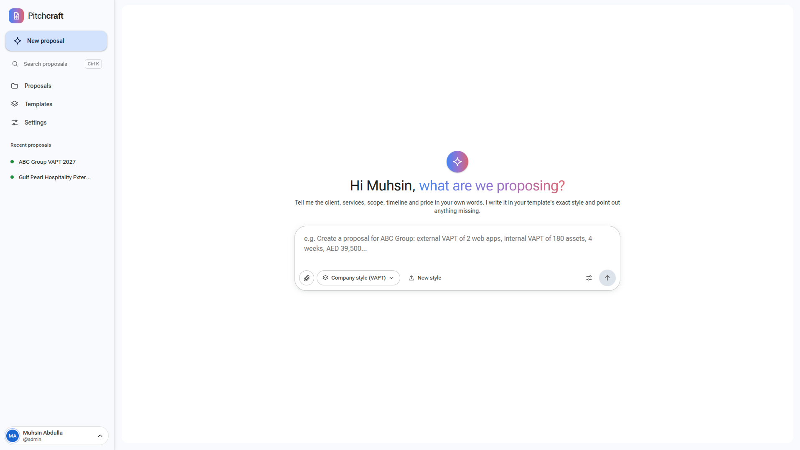
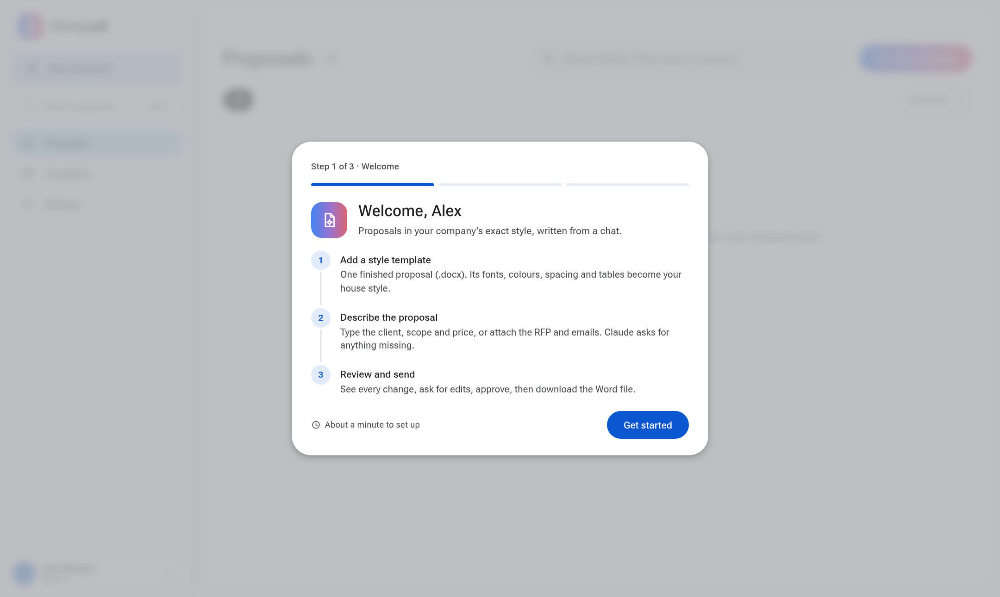

<div align="center">

# Pitchcraft

**Open-source AI proposal generator that writes in your company's exact Word template.**

[](LICENSE)
[](https://www.python.org/)
[](#quick-start)



</div>

Pitchcraft turns a short brief into a finished, ready-to-send Word proposal. Upload one proposal your team has already sent as the template. Then describe the client, scope and price in a chat, or attach the RFP. Pitchcraft writes the new proposal and keeps the template's layout, styles, tables, headers and footers exactly as they are.

## Features

- **Your template, exactly.** New content is cloned from your own document, so nothing needs reformatting.
- **Chat to create and edit.** Ask for changes later in the same thread, and every related figure is updated.
- **Asks, never guesses.** Missing prices, dates or names are listed as questions instead of invented.
- **Built-in checks.** Numbers, leftover client details, placeholders and formatting are checked on every version.
- **Review workflow.** Versions, a redline of changes between any two versions, and approval status.
- **Any input.** PDF, Word, Excel, PowerPoint, email and screenshot attachments.
- **Self-hosted.** Runs on your server with your own Claude API key. No telemetry.

## Quick start

```bash
git clone https://github.com/muhsinbinirshad/pitchcraft.git
cd pitchcraft
docker compose up -d --build
```

Open http://127.0.0.1:8600 and sign in with `admin` / `admin`. You'll be asked to set a new password. A short tour then helps you add your first template.

<p align="center"></p>

Add a Claude API key in **Settings → Claude & AI**, or set it for the whole server in `.env` (see [`.env.example`](.env.example)).

**Without Docker** (Linux or macOS), the installer sets up LibreOffice, Poppler, Python and the web UI, then checks that previews render:

```bash
./scripts/install.sh
.venv/bin/pitchcraft serve
```

See [Installation](docs/installation.md) for manual setup and troubleshooting.

## How it works

Claude never edits the document directly. It reads an outline of the template and returns structured edit operations. A deterministic Word engine then applies them by copying the template's own elements, and checks the result before saving a new version. [Read more](docs/architecture.md).

## Documentation

- [Installation](docs/installation.md): Docker, installer, manual setup, troubleshooting
- [Configuration](docs/configuration.md): environment variables, command line, production
- [Architecture](docs/architecture.md): how edits are planned, applied and checked

## Privacy

Documents, proposals and users are stored as files on your server. To plan the edits, the document outline and your attachments are sent to the Anthropic API. Nothing else leaves the server.

## Contributing

Contributions are welcome. See [CONTRIBUTING.md](CONTRIBUTING.md). To report a security issue, see [SECURITY.md](SECURITY.md).

## License

[MIT](LICENSE)
