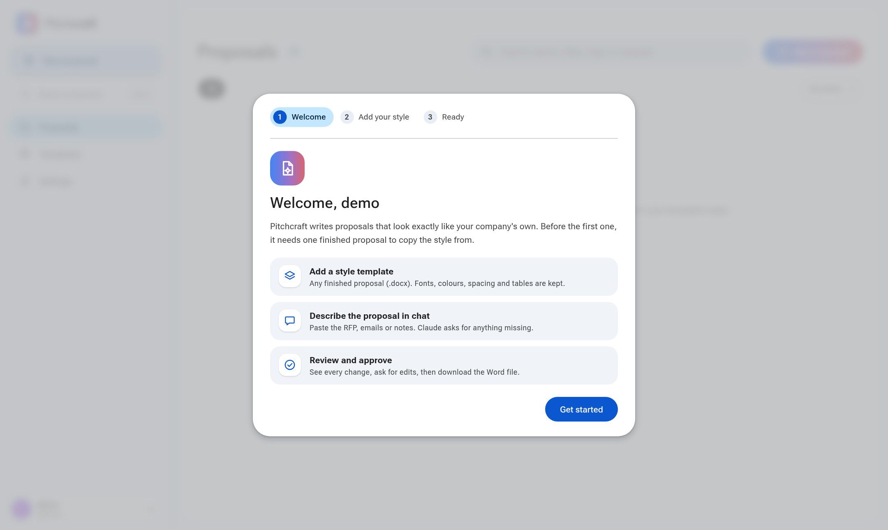

<div align="center">

# Pitchcraft

### Open-source AI proposal generator that writes in your company's exact Word template style

Describe the client and scope in a chat and attach the RFP. Pitchcraft writes a ready-to-send business proposal as a `.docx`, keeping your fonts, colours, tables, headers and footers.

[](LICENSE)
[](https://www.python.org/)
[](https://nextjs.org/)
[](#quick-start-with-docker)
[](https://www.anthropic.com/api)
[](#self-hosting-and-privacy)

[Quick start](#quick-start-with-docker) ·
[Features](#features) ·
[How it works](#how-it-works) ·
[Configuration](#configuration) ·
[FAQ](#faq) ·
[Contributing](#contributing)


</div>

---

## Screenshots

| Write a proposal by chatting | First-run setup |
|---|---|
|  | <picture><source media="(prefers-color-scheme: dark)" srcset="docs/images/onboarding-dark.png"></picture> |

## Why Pitchcraft?

Most AI proposal writers give you generic text that someone then pastes into the company template and fixes by hand. Pitchcraft works the other way round: **your existing proposal is the template.** Upload one finished `.docx` your team already sent, and every new proposal comes out in the same layout, styles and branding, with nothing to reformat.

Pitchcraft is built for teams that send a lot of proposals, such as:
- consulting firms and agencies;
- IT and cybersecurity providers;
- system integrators;
- B2B sales teams;
- anyone answering RFPs and tenders.

| | Generic AI writer | Pitchcraft |
|---|---|---|
| Output | Plain text or Markdown | A real Word `.docx` in your template |
| Formatting | Fixed by hand | Copied exactly from your template |
| Missing facts | Guessed or made up | Asked for in the chat |
| Old client details | Easy to leave behind | Checked automatically |
| Changes later | Start over | Same chat thread, new version |
| Hosting | Vendor cloud | Your own server, your own API key |

## Features

### Write proposals by chatting
- **New proposal from a template.** Pick a template, describe the client, scope, timeline and price, and attach the RFP or emails. Claude writes the client-specific parts and keeps your company boilerplate.
- **Asks instead of guessing.** If something is missing, such as a price, a date or a contact name, Pitchcraft lists exactly what it needs. You reply in the chat to finish.
- **Edit any proposal later.** For example: "make the scope shorter", "add a web app pentest for 6,000", "change the timeline to 10 weeks". Every mention of a changed fact is updated, including totals, durations and summary tables.
- **Change the structure, not only the text.** You can add or remove sections and pages, and create new tables of any shape. New content always reuses your template's styles.

### Attach anything
You can drop, paste or pick these file types in the chat box:
- **Documents:** PDF, Word (`.docx`, `.doc`, `.odt`, `.rtf`).
- **Spreadsheets:** Excel (`.xlsx`, `.xls`), `.ods`, `.csv`.
- **Slides:** PowerPoint (`.pptx`, `.ppt`), `.odp`.
- **Other:** emails (`.eml`), screenshots and images, plain text, Markdown, JSON and HTML.

### Review like a pro
- **Versions.** Every message creates a new version (v1, v2, …). You can view, download, duplicate or continue from any of them.
- **Changes view.** A redline of what changed between any two versions, from single words in table cells to whole tables. You can download it as PDF for QA and QC sign-off.
- **Approve and track status.** Proposals move through draft, approved, sent and archived, and are tagged automatically.
- **Print-accurate previews.** Pages are rendered with LibreOffice and shown with pdf.js. Embedded fonts are used, and missing fonts are fetched from Google Fonts.

### Built-in quality checks
After every version, Pitchcraft checks that:
- every number was given by you or calculated from what you gave;
- changed values no longer appear anywhere else;
- the previous client's details from the template are gone;
- no `[placeholder]` text was written;
- no formatting was added that the template doesn't have;
- tables and sections are well formed and the document renders cleanly.

### For teams
- **Template library.** Each upload is checked. It must be a real proposal, with no macros and no text that tries to instruct an AI.
- **Sign-in.** Multiple users with profiles. Passwords are stored as PBKDF2 hashes and sessions use signed, HTTP-only cookies.
- **Search.** Search every proposal with <kbd>Ctrl</kbd>+<kbd>K</kbd>; the proposals page groups them by date.
- **Interface.** Light, dark and system themes; Focus and Canvas layouts; a mobile-friendly layout.

## How it works

```
            ┌──────────────┐     outline with ids      ┌──────────────┐
 your .docx │  Word engine │ ────────────────────────▶ │    Claude    │
 template ─▶│   (no AI)    │                           │   planner    │
            │              │ ◀──────────────────────── │              │
            └──────┬───────┘    edit operations (JSON) └──────────────┘
                   │ applies ops by cloning existing elements
                   ▼
            checks (numbers, leftovers, styles, render) ──▶ new version (.docx + preview)
```

1. **Claude plans, code applies.** Claude never writes XML. It reads an outline in which every block (body text, tables, headers and footers) has an id. It returns structured edit operations: replace, insert, delete, insert table and delete range.
2. **New content is always a copy.** New headings, bullets, rows and tables are cloned from elements already in the template. Formatting can only come from your document.
3. **Every edit cites its source.** Each operation names its evidence. Decisions that are missing come back as questions.
4. **Checks, then a review pass.** The engine checks the result, then Claude re-reads it and fixes anything left over. An optional visual check compares the changed pages before and after.

Pitchcraft uses Claude Opus 5.5 by default for the best accuracy. You can switch to Claude Sonnet 5.5, which is faster and cheaper, in Settings. It uses structured outputs, adaptive thinking and prompt caching.

## Quick start with Docker

```bash
git clone https://github.com/OWNER/pitchcraft.git
cd pitchcraft
cp .env.example .env && chmod 600 .env   # optional: add ANTHROPIC_API_KEY for everyone
docker compose up -d --build
```

Open **http://127.0.0.1:8600**. The first visit creates the admin account. A short setup tour then helps you add your first template.

You don't have to put a key on the server: each user can paste their own Claude API key under **Settings → Claude & AI**, and it stays in their browser.

<details>
<summary>Plain <code>docker run</code></summary>

```bash
docker build -t pitchcraft .
docker run -d --name pitchcraft \
  -p 127.0.0.1:8600:8600 \
  --env-file .env \
  -v pitchcraft-data:/data \
  --restart unless-stopped \
  pitchcraft
```
</details>

About the image:
- **Contents:** the API, the built web UI, LibreOffice for rendering, and Office-compatible and multilingual fonts.
- **Hardening:** it runs as a non-root user, with a read-only root filesystem in Compose, all Linux capabilities dropped, and a health check on `/api/health`.
- **Data:** proposals, templates, users and the font cache are kept in the `pitchcraft-data` volume, mounted at `/data`.

## Install without Docker

The installer sets up everything Pitchcraft needs, including the LibreOffice and Poppler tools that page previews depend on:

```bash
git clone https://github.com/OWNER/pitchcraft.git
cd pitchcraft
./scripts/install.sh        # asks before installing system packages; add --yes to skip the prompt
.venv/bin/pitchcraft serve --data data
```

It runs these steps:
1. Installs system packages with your package manager:
   - **LibreOffice** (Writer, Calc, Impress) renders previews and reads `.doc`, `.ppt` and `.xls` attachments.
   - **Poppler** (`pdftoppm`, `pdftotext`) turns PDFs into page images and reads PDF attachments.
   - Office-compatible fonts.
2. Creates the Python environment in `.venv`, using `uv` if you have it, otherwise `pip`.
3. Builds the web UI. If your system's Node.js is older than 20, it downloads the official Node.js 22 into `.tools/` and verifies its checksum. No sudo is needed for this step.
4. Creates a private `.env` file.
5. Runs `pitchcraft doctor`, which includes a real test render.

Supported systems:
- Debian and Ubuntu (apt)
- Fedora and RHEL (dnf)
- Arch (pacman)
- openSUSE (zypper)
- macOS (Homebrew)

On Windows, use Docker or WSL. Use `./scripts/install.sh --no-system` to skip the system packages if you install them yourself.

<details>
<summary>Install the system packages by hand</summary>

| System | Command |
|---|---|
| Debian / Ubuntu | `sudo apt install libreoffice-writer-nogui libreoffice-calc-nogui libreoffice-impress-nogui poppler-utils fonts-liberation fonts-crosextra-carlito fonts-crosextra-caladea` |
| Fedora / RHEL | `sudo dnf install libreoffice-writer libreoffice-calc libreoffice-impress poppler-utils liberation-fonts google-carlito-fonts` |
| Arch | `sudo pacman -S libreoffice-fresh poppler ttf-liberation ttf-carlito ttf-caladea` |
| openSUSE | `sudo zypper install libreoffice-writer libreoffice-calc libreoffice-impress poppler-tools liberation-fonts` |
| macOS | `brew install --cask libreoffice && brew install poppler` |

Then run `make setup && make build`. You also need Python 3.11+ and Node.js 20+.
</details>

### Check your setup

```console
$ pitchcraft doctor
  ✓ Python                 3.12.8
  ✓ libreoffice            LibreOffice 25.2.3.2
  ✓ pdftoppm               /usr/bin/pdftoppm
  ✓ pdftotext              /usr/bin/pdftotext
  ✓ Preview render         1 page in 0.8s
  ✓ Excel (.xls) reader    xlrd
  ✓ Web UI                 frontend/out
  ✓ Data folder            data (writable)
  ! Claude API key         not set: users add their own in Settings, or put ANTHROPIC_API_KEY in .env
```

If something is missing, the server also prints a warning on start, and the app shows a banner saying which tool is missing.

For development with hot reload, run `make dev`. The API runs on `:8600` and Next.js on `:3600`.

## Configuration

Pitchcraft reads its settings from the environment, or from a `.env` file in the working directory. To use a different file, run `pitchcraft serve --env-file path`. Real environment variables override the file. See [`.env.example`](.env.example).

| Variable | Default | Description |
|---|---|---|
| `ANTHROPIC_API_KEY` | – | Server-wide Claude API key. Optional when users add their own in Settings. |
| `PITCHCRAFT_DATA` | `data` | Folder for proposals, templates, users and versions. |
| `PITCHCRAFT_AUTH` | `on` | `off` disables sign-in. Use only for single-user local setups. |
| `PITCHCRAFT_SECURE_COOKIE` | `0` | Set to `1` when serving over HTTPS. |
| `PITCHCRAFT_FETCH_FONTS` | `on` | Downloads fonts the template uses but the server lacks, from Google Fonts. |
| `PITCHCRAFT_FONT_CACHE` | `~/.cache/pitchcraft/fonts` | Where downloaded fonts are cached. |
| `PITCHCRAFT_SOFFICE` | auto | Path to the LibreOffice `soffice` binary when it isn't on `PATH` or in a standard location. |
| `PITCHCRAFT_FONTS` | – | Folder of extra `.ttf` and `.otf` fonts, such as your licensed brand fonts. |
| `PITCHCRAFT_WEB` | `frontend/out` | Folder of the built web UI. |
| `PITCHCRAFT_PORT` | `8600` | Host port used by `docker-compose.yml`. |

## Command line

```bash
pitchcraft serve --port 8600 --data data                  # run the web app
pitchcraft adduser alice --admin --data data              # create a login
pitchcraft import-templates a.docx b.docx --data data --default a.docx   # bulk-load templates
pitchcraft outline proposal.docx                          # print the outline Claude sees
pitchcraft apply proposal.docx plan.json -o out.docx      # apply a plan offline and print the checks
```

## Troubleshooting

**Previews are blank, or the app says "Previews are off".**
LibreOffice or Poppler is missing. Run `pitchcraft doctor`, which names the missing tool and the command that installs it. If LibreOffice is installed somewhere unusual, set `PITCHCRAFT_SOFFICE=/path/to/soffice`. The Docker image already includes both.

**Fonts look different in the preview.**
The preview uses fonts embedded in the `.docx`, then Google Fonts, then installed fonts. For licensed brand fonts, put the `.ttf` or `.otf` files in a folder and set `PITCHCRAFT_FONTS` to that folder. Word always shows the real fonts if they're installed.

**`npm ci` fails or the web UI isn't built.**
You need Node.js 20 or newer. `./scripts/install.sh` installs it locally if yours is older.

## Self-hosting and privacy

- **Your data stays on your server.** Documents, proposals and users are stored as plain files in your data folder. There's no telemetry and no external database.
- **What goes to Anthropic.** To plan the edits, the document outline and your attachments are sent to the Claude API, under [Anthropic's commercial terms](https://www.anthropic.com/legal/commercial-terms). Nothing else leaves the server except optional Google Fonts downloads.
- **Keep keys out of git.** Use `.env`, which is listed in `.gitignore` and `.dockerignore`, or your platform's secret store. Never pass keys on the command line.
- **Production checklist:**
  - Put Pitchcraft behind a reverse proxy with HTTPS, such as Caddy, nginx or Traefik.
  - Set `PITCHCRAFT_SECURE_COOKIE=1`.
  - Back up the data volume.

## Project structure

Pitchcraft is a modular monolith: one Python service plus a static web UI.

```
pitchcraft/
  engine/     Word engine, no AI: docx package, outline ids, edit ops with rollback,
              checks, structural diff, template inspection, LibreOffice rendering
  ai/         Claude client (structured outputs, adaptive thinking), prompts,
              attachment readers (PDF, Office, images, email), planner and review pass
  pipeline/   File store (templates, proposals, versions, turns) and the
              plan → questions → apply → check workflow
  api/        FastAPI routes, sign-in, serves the web UI
frontend/     Next.js 15 static export, Material 3 design, light and dark themes
tests/        Offline tests, live end-to-end scripts, browser walk-through
```

## Tests

```bash
make test                                  # offline: engine, API, auth, versions, diff, attachments
docker build --target test .               # the same tests inside the Docker image
make ui USER_NAME=admin USER_PASS=...      # browser walk-through with screenshots
```

The full-document tests need a real proposal. Put any finished `.docx` at `private/fixtures/client_base.docx`. The `private/` folder is git-ignored, so client documents never get published. Without it, those tests are skipped.

## FAQ

**What is an AI proposal generator?**
Software that drafts business proposals from a short brief: sales proposals, project proposals, RFP responses and tender submissions. Pitchcraft is an open-source AI proposal generator that writes directly into your own Microsoft Word template.

**Does it work with my existing Word proposal template?**
Yes. Any `.docx` proposal works, with any layout, tables, cover page, headers and footers. You don't need a special template format, placeholders or mail-merge fields.

**Can it answer an RFP?**
Yes. Attach the RFP (PDF, Word or Excel) and describe what you're offering. Pitchcraft uses the RFP as a source and lists any gaps for you to fill.

**Is it free?**
Pitchcraft is free and open source under the MIT license. You pay only for your own Claude API usage.

**Which AI model does it use?**
Anthropic's Claude, through the official API. Claude Opus 5.5 is the default, and you can choose Claude Sonnet 5.5 in Settings.

**Can it invent prices or facts?**
It's designed not to. Every number must come from your message, your attachments, or a calculation based on them, and the checks flag anything that doesn't. Missing information is asked for, not made up.

**Can I run it on-premises?**
Yes. The app runs entirely on your own server or laptop. Only the Claude API calls need internet access.

**Does it work with Google Docs or PDF?**
It writes Word `.docx` files, which open in Word, Google Docs and LibreOffice. It also offers PDF previews and a PDF redline of changes.

## Roadmap

- [ ] Sample templates and a demo dataset
- [ ] Clause library: reusable, pre-approved sections
- [ ] Single sign-on (OIDC)
- [ ] Pluggable model providers

## Contributing

Contributions are welcome:

1. Fork the repo and create a branch: `git checkout -b feat/my-change`.
2. Run `make setup`, then run `make test` before and after your change.
3. Keep the engine free of AI calls. AI code goes in `pitchcraft/ai/`.
4. Open a pull request that explains what changed and why.

Please don't commit real client documents, API keys or `.env` files. Keep client material in `private/`, which is git-ignored.

## Security

To report a vulnerability, please use GitHub's private Security Advisories rather than a public issue.

## License

[MIT](LICENSE) © Pitchcraft contributors

---

<sub>**Keywords:** AI proposal generator · open-source proposal software · AI proposal writer · RFP response automation · tender and bid writing · business proposal template · sales proposal generator · consulting proposal software · Word docx automation · self-hosted · Claude API · Anthropic</sub>
